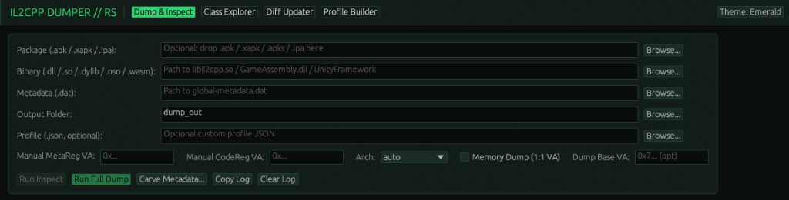
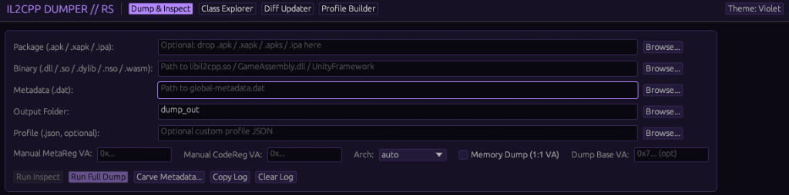
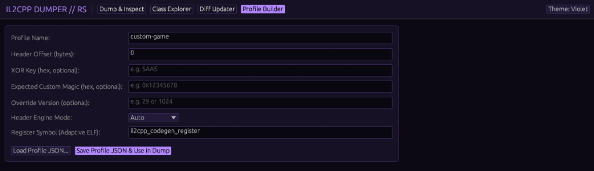

# il2cpp-dumper-rs

[](https://github.com/blender1337/il2cpp-dumper-rs/actions/workflows/ci.yml)
[](https://github.com/blender1337/il2cpp-dumper-rs/actions/workflows/release.yml)
[](LICENSE)

Fast, cross-platform static Unity IL2CPP metadata and binary dumper written in Rust. Works without launching the target runtime or installing .NET/Mono, supporting legacy Unity (`v16`) through **Unity 6 (`v39` / `v104+`)** as well as custom forked builds.



<details>
<summary>More screenshots (Violet theme &amp; Profile Builder)</summary>





</details>

## Highlights

- **Wide Unity Version Coverage:** Legacy `v16-v24.1` (flat `methodPointers[]`), standard `v24.2-v31`, **Unity 6 (`v35-v39`, `v104+`)** with variable-width metadata indices, plus an **Adaptive Engine** (`v200+` / chain-header layouts).
- **Direct Mobile Package Extraction:** Drop or pass `.apk`, `.xapk`, `.apks` (split APKs), or `.ipa` archives directly — extracts `libil2cpp.so` / `UnityFramework` and `global-metadata.dat` in memory (`--arch arm64-v8a|armeabi-v7a|x86_64`).
- **Hardened Binary Loaders:**
  - **ELF** (`arm64`, `armv7`, `x86_64`, `x86`): `.rela.dyn`, `.rel.dyn`, `.relr.dyn` (Android NDK r23+), `PT_DYNAMIC` / `DT_HASH` / `DT_GNU_HASH` fallback for sectionless (`sstrip`) binaries, and `.dynsym`/`.init_array` AArch64 tracing.
  - **PE** (`x86_64`, `x86`, `arm64`): section scan plus `.CRT$XCU` / `.rdata` registration constructor tracing.
  - **Mach-O** (`arm64`, `x86_64`, Fat): `LC_DYLD_CHAINED_FIXUPS` pointer decoding (`PTR_64`, `PTR_64_OFFSET`, `ARM64E`, `USERLAND`, `USERLAND24`) and FairPlay `cryptid` warning.
  - **NSO (`NSO0`)** with built-in pure-Rust LZ4 block decompression (Nintendo Switch) and **WebAssembly (`.wasm`)** Data-segment linear memory loader.
  - **Memory Dumps:** `--memory-dump` and arbitrary `--image-base 0x...` runtime rebase translation.
- **Ready-to-Use Outputs:** `dump.cs`, padded C/C++ `il2cpp.h` (unique struct names, C/C++ keyword escaping, sequential open generics, `stdint.h` primitives), `script.json` (`ScriptMethod` with full C signatures, `ScriptString`, `ScriptMetadata`), and standalone `ida_import.py` (`SN_FORCE`) + `ghidra_import.py`.
- **Native Desktop GUI (`egui`):** Emerald / Violet themes, drag-and-drop packages/binaries, virtualized **Class Explorer** with C++ `#define`/`constexpr` copy, **Diff Updater** (`dump` v1 vs v2), and **Profile Builder** (XOR key, header shift, custom magic).

## Support Matrix

| Capability | Details | Status |
| :--- | :--- | :--- |
| Runtime | Standalone native binary (zero external runtime) | Supported |
| Unity Metadata | Legacy `v16-v24.1`, standard `v24.2-v31`, Unity 6 `v35-v39` / variable-width | Supported |
| Custom / Forked Metadata | Adaptive chain-header engine + JSON `--profile` (XOR, shift, magic) | Supported |
| Mobile Packages | Direct in-memory `.apk`, `.xapk`, `.apks`, `.ipa` extraction | Supported |
| Binary Formats | ELF (`DT_RELR`, stripped `PT_DYNAMIC`), PE (`.CRT$XCU`), Mach-O (`LC_DYLD_CHAINED_FIXUPS`), Switch `NSO0`, `.wasm` | Supported |
| Memory Dumps | Raw dumps via `--memory-dump` and arbitrary `--image-base` rebase | Supported |
| Codegen & RE Exports | `dump.cs`, padded C/C++ `il2cpp.h`, `script.json`, `ida_import.py`, `ghidra_import.py` | Supported |
| Desktop Tooling | Built-in `egui` GUI, Class Explorer, Patch Diff Updater, Profile Builder | Supported |
| `DummyDll/*.dll` | Managed stub assemblies for dnSpy / ILSpy | Planned |

## Quick Start

### Desktop GUI

Launch without arguments or run `gui`:

```powershell
il2cpp-dumper-rs
# or explicitly:
il2cpp-dumper-rs gui
```

Drag and drop a `.apk` / `.xapk` / `.ipa` package (or a binary + `global-metadata.dat`) anywhere onto the window.

### CLI Usage

#### 1. Dump from a Mobile Package (`.apk` / `.xapk` / `.apks` / `.ipa`)

```powershell
il2cpp-dumper-rs dump --package game.apk --out dump_out
# Specify ABI if multiple native architectures are present:
il2cpp-dumper-rs dump --package game.xapk --arch arm64-v8a --out dump_out
```

#### 2. Dump from Binary + Metadata

```powershell
il2cpp-dumper-rs dump --binary libil2cpp.so --metadata global-metadata.dat --out dump_out
```

Useful recovery flags:
- `--image-base 0x7A12340000` — rebase a raw runtime memory dump to its original process load address.
- `--memory-dump` — treat binary VAs as 1:1 file offsets (`base = 0x0` dumps).
- `--meta-reg 0x...` / `--code-reg 0x...` — override `Il2CppMetadataRegistration` or `Il2CppCodeRegistration` manually.
- `--profile profile.json` — apply header offset stripping, XOR decryption, custom magic fixups, or custom registration symbol names.

#### 3. Inspect Without Writing Files

```powershell
il2cpp-dumper-rs inspect --package game.ipa
il2cpp-dumper-rs inspect --metadata global-metadata.dat --binary GameAssembly.dll
```

#### 4. Diff Two `dump.cs` Patches

```powershell
il2cpp-dumper-rs diff --old v1\dump.cs --new v2\dump.cs --filter PlayerController --changed --cpp
```

#### 5. Carve Metadata from a Raw RAM Dump

```powershell
il2cpp-dumper-rs carve --input process_ram.bin --out carved-metadata.dat
```

## Generated Files

Running `dump` writes the following files into `--out`:

- `dump.cs` — Full C# type, enum underlying type, field offset, property, and method RVA listing.
- `il2cpp.h` — ISO C-compliant header with `Il2CppObject`/`Il2CppString`/`Il2CppArray` base definitions, mapped C types, byte padding, and deduplicated identifiers.
- `script.json` — Structured JSON containing `ScriptMethod` (with C signatures), `ScriptString`, `ScriptMetadata`, and `Addresses`.
- `ida_import.py` — Standalone IDAPython script that applies function names (`SN_FORCE`) and C signatures.
- `ghidra_import.py` — Standalone Ghidra Script Manager importer for function names and signature comments.

## Building from Source

Requires stable Rust (`cargo`):

```bash
git clone https://github.com/blender1337/il2cpp-dumper-rs.git
cd il2cpp-dumper-rs
cargo test
cargo build --release
```

On Debian/Ubuntu Linux, install the native GUI development libraries before building:

```bash
sudo apt-get install -y pkg-config libgtk-3-dev libxcb-render0-dev libxcb-shape0-dev libxcb-xfixes0-dev libxkbcommon-dev libssl-dev libgl1-mesa-dev libwayland-dev
```

## Profile Format (`--profile`)

```json
{
  "name": "custom-xor-game",
  "header_offset": 0,
  "xor_key_hex": "5AA5",
  "xor_range": null,
  "expected_magic": 305419896,
  "override_version": null,
  "header_mode": null,
  "register_symbol": "il2cpp_codegen_register"
}
```

## License

Licensed under the [MIT License](LICENSE).
